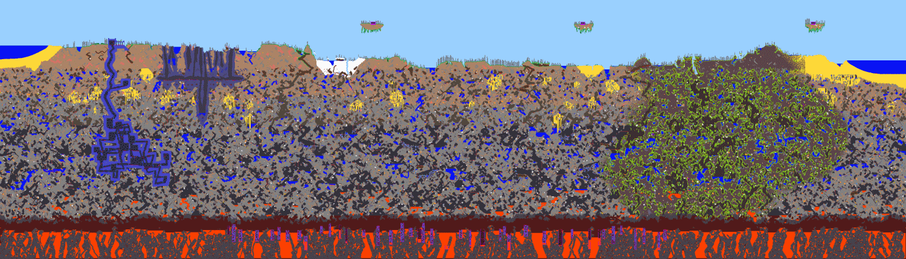

<a href="https://ema.orionyx.dev">
  
</a>

<div align="center">

# Hola, soy Ema 👋

<a href="https://ema.orionyx.dev">
  
</a>

<br />

<a href="https://ema.orionyx.dev"></a>
<a href="https://www.linkedin.com/in/emanuel-esquivel/"></a>
<a href="https://x.com/ema11412"></a>
<a href="https://www.instagram.com/ema11412.tar.gz/"></a>
<a href="mailto:ema@orionyx.dev"></a>

</div>


### `$ whoami`

```python
class Ema:
    nombre    = "Emanuel Esquivel"
    ubicacion = "Costa Rica 🇨🇷 · remoto"
    rol       = "Sr. AI Analyst · Freelance"
    antes     = ["Sr Backend Developer & Data Scientist @ Grupo OLA",
                 "Sr Odoo Developer @ Grupo OLA"]

    hago      = ["APIs y microservicios con Django / FastAPI",
                 "Módulos custom y automatización en Odoo",
                 "Modelos de ML, LLMs y pipelines de datos",
                 "Infra propia: Docker, Caddy, Postgres y CI/CD"]

    estrella  = "Space Pirates 🏴‍☠️ · space-pirates.orionyx.dev"
    ahora     = "Simulaciones interactivas de física y matemáticas en la web"
```


### 🏴‍☠️ Proyecto estrella

<a href="https://space-pirates.orionyx.dev/">
  
</a>

<div align="center">

**Space Pirates** es un juego de cartas online de bazas con apuestas, ambientado en el espacio. Cada ronda apuestas cuántas bazas vas a ganar: si aciertas exacto sumas puntos y si fallas, aunque sea por una, los pierdes. Creas una sala, compartes el código y juegas desde el celular con tus amigos. Si faltan jugadores, completas la mesa con bots.

<a href="https://space-pirates.orionyx.dev/">
  
</a>

<a href="https://space-pirates.orionyx.dev/"></a>

</div>

<table>
  <tr>
    <td width="33%" valign="top">
      <h4>🃏 87 cartas ilustradas</h4>
      Un mazo de 74 cartas con Capitanes, Hechiceras, el Emperador del Vacío, el Leviatán y la Tormenta Solar, más dos expansiones con 13 cartas que rompen las reglas. Las especiales tienen arte original, sonido y voz propia.
    </td>
    <td width="33%" valign="top">
      <h4>🌋 29 eventos al azar</h4>
      Motines, eclipses, lluvia de oro y niebla. Además hay dos paquetes con sabor tico: <b>Leyendas Ticas</b> (el Cadejos, la Llorona, la Cegua) y <b>Vida Tica</b> (la Suegra, Hacienda, el Marchamo, la Chancla).
    </td>
    <td width="33%" valign="top">
      <h4>🤖 Bots que no hacen trampa</h4>
      Juegan solo con su mano y lo que hay en la mesa. Toman el lugar de quien abandona y juegan por quien se queda sin tiempo. Las pruebas corren 280 partidas completas entre bots.
    </td>
  </tr>
  <tr>
    <td width="33%" valign="top">
      <h4>⚡ Tiempo real con autoridad</h4>
      El servidor es el único que decide: cada jugada se valida dentro de una transacción con la sala bloqueada. Cada jugador recibe solo lo que puede saber, y los cambios llegan por <code>LISTEN/NOTIFY</code> de Postgres y Server-Sent Events.
    </td>
    <td width="33%" valign="top">
      <h4>🏆 Perfil de pirata</h4>
      Cuentas con Discord, niveles, logros, 28 estandartes que se desbloquean jugando, ranking, rivales, desafíos diarios y semanales, y eventos de temporada como <i>Navidad en el Vacío</i>.
    </td>
    <td width="33%" valign="top">
      <h4>🎙️ Se escucha y se instala</h4>
      Narrador y voces para cada personaje, banda sonora por lugar, rueda de gestos y lanzables en la mesa. Es una PWA pensada primero para el celular y permite reconectarse a una partida en curso.
    </td>
  </tr>
</table>

<table>
  <tr>
    <td align="center" width="25%"><br /><sub><b>Anomalías del Vacío</b></sub></td>
    <td align="center" width="25%"><br /><sub><b>Bandera Negra</b></sub></td>
    <td align="center" width="25%"><br /><sub><b>Leyendas Ticas</b></sub></td>
    <td align="center" width="25%"><br /><sub><b>Vida Tica</b></sub></td>
  </tr>
</table>

<div align="center">


<sub>🔒 Código privado · 📱 Próximamente en Steam, Google Play y App Store</sub>

</div>


### 🚀 Más proyectos

<table>
  <tr>
    <td width="50%" valign="top">
      <h4>🕵️ <a href="https://the-impostor-game.orionyx.dev/">Juego del Impostor</a></h4>
      Juego multijugador de deducción social para jugar desde el celular: pistas por turnos, debate y votación. El servidor tiene la autoridad sobre PostgreSQL y el tiempo real va por Server-Sent Events.
      <br /><br />
      
      
      
      <br /><a href="https://the-impostor-game.orionyx.dev/"><b>▶ Jugar</b></a>
    </td>
    <td width="50%" valign="top">
      <h4>⚛️ <a href="https://ema.orionyx.dev/lab">Laboratorio de física</a></h4>
      Más de 15 simulaciones interactivas: fluidos en la GPU, ecuaciones de Maxwell, orbitales del hidrógeno, un agujero negro, atractores extraños, Mandelbrot y patrones de Turing.
      <br /><br />
      
      
      
      <br /><a href="https://ema.orionyx.dev/lab"><b>▶ Explorar</b></a>
    </td>
  </tr>
  <tr>
    <td width="50%" valign="top">
      <h4>🖥️ Infraestructura self-hosted</h4>
      Un VPS propio donde corren mis proyectos en contenedores, con reverse proxy y HTTPS automático, PostgreSQL compartido y despliegue continuo en cada push. Mi portafolio corre ahí.
      <br /><br />
      
      
      
    </td>
    <td width="50%" valign="top">
      <h4>📐 <a href="https://github.com/ema11412/FormularioSenales">Formulario de Señales y Sistemas</a></h4>
      Formulario del curso EL4703 del TEC: variable compleja, mapeos, trigonometría, funciones hiperbólicas e integrales. Lo escribí en LaTeX y ahora también vive en la web.
      <br /><br />
      
      
      <br /><a href="https://ema.orionyx.dev/lab/recursos"><b>▶ Ver formulario</b></a>
    </td>
  </tr>
</table>

### 🛠️ Stack

**Backend y datos**

<a href="https://skillicons.dev"></a>


**Infra y DevOps**


**Frontend**


<details>
<summary><b>También he trabajado con…</b></summary>
<br />


<br /><br />


</details>

### 🎧 Sonando ahora

<!-- Si deja de verse, vuelve a conectar Spotify en https://spotify-github-profile.kittinanx.com/api/login -->
<p align="center">
  <a href="https://github.com/kittinan/spotify-github-profile">
    
  </a>
</p>


<picture>
  <source media="(prefers-color-scheme: dark)" srcset="https://raw.githubusercontent.com/ema11412/ema11412/output/snake-dark.svg" />
  <source media="(prefers-color-scheme: light)" srcset="https://raw.githubusercontent.com/ema11412/ema11412/output/snake.svg" />
  
</picture>
